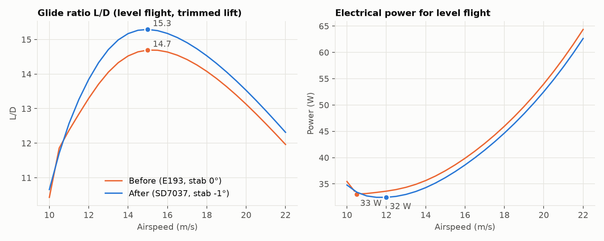
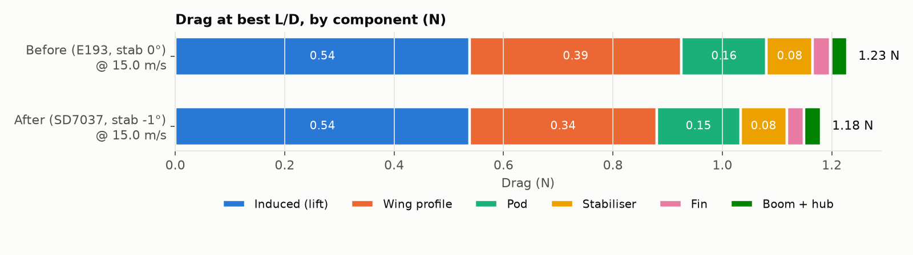
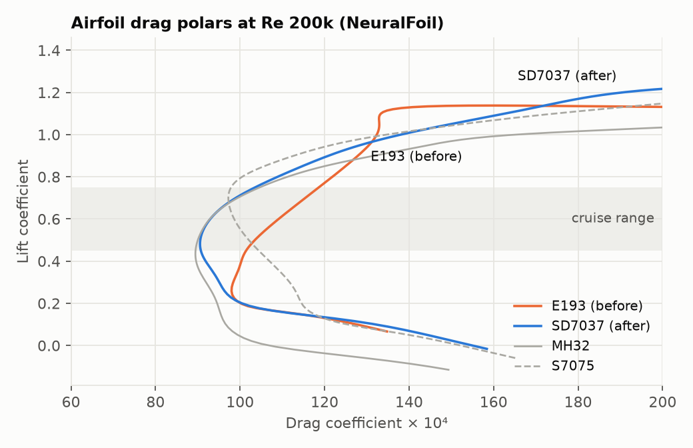

# Aerodynamics

This document analyses the airframe in this repo and records the changes made to make it more efficient. It is regenerated by `aero/report.py` from the same parameters as the CAD (`cad/params.py`).

Design point: **1.84 kg all-up**: printed in PLA, with a 4S 5200 mAh LiPo and the nose weight that balances it (the weight budget is in `cad/assembly.py`). Sea level, CG 66 mm behind the wing LE.

## Result

| | Before | After | Change |
|---|---|---|---|
| Best glide ratio (L/D) | 14.69 at 15.0 m/s | 15.29 at 15.0 m/s | +4.1% |
| Drag at best L/D | 1.229 N | 1.181 N | -3.9% |
| Minimum power (level flight) | 33.1 W at 10.5 m/s | 32.4 W at 12.0 m/s | -1.9% |
| Endurance, 4S 5200 mAh (model)* | 2.0 h | 2.0 h | +1.9% |
| Pitching moment at cruise, elevator neutral | -0.039 | -0.007 | elevator now ~neutral |
| Neutral point / static margin | 92 mm / 15% | 93 mm / 14% | |

\*At the minimum-power speed with 55% propulsion efficiency, 4 W of avionics and 65 Wh usable. That's still air with no climbs or turns. Expect real flights to get roughly 60–70% of this.

## Where the drag comes from

| Component | Before (N) | After (N) |
|---|---|---|
| Induced (lift) | 0.538 | 0.538 |
| Wing profile | 0.387 | 0.342 |
| Pod | 0.156 | 0.153 |
| Stabiliser | 0.084 | 0.084 |
| Fin | 0.032 | 0.032 |
| Boom + hub | 0.031 | 0.031 |
| **Total** | **1.229** | **1.181** |

- **Induced drag is 46% of the total.** Induced drag is the cost of making lift. At a fixed weight it depends only on wingspan and span efficiency, not on wing area or airfoil. With the span fixed at the Lark's 1290 mm, the remaining levers are weight (induced drag goes with weight²: 10% lighter means about 19% less induced drag) and span.
- **Wing profile drag comes next.** The airfoil change cut it. See below.
- **The pod** is about an eighth of the drag. It is sized by the battery bay (a 4S 5200 mAh LiPo, up to 140 × 48 × 48 mm), and its length-to-width ratio of about 3.7 is close to the lowest-drag value for the volume it holds.
- **The tail** (stabiliser, fin, boom and hub) is about 12%. The tail volume (0.50 horizontal, 0.030 vertical) is normal, so shrinking it would save little and cost stability.

## Changes made

### 1. Wing airfoil: E193 → SD7037

At the cruise Reynolds number (Re ≈ 200k, from 200 mm chord at 15 m/s), SD7037 has noticeably less profile drag than E193 across the whole cruise lift range. It has a similar pitching moment, more maximum lift, and enough thickness for the 10 mm spar and the flat-lying servo. It is also among the most wind-tunnel-tested airfoils at this size (UIUC low-speed tests), so the prediction can be trusted.

| Airfoil | t/c | cd @ cl 0.45 | cd @ cl 0.60 | cd @ cl 0.75 | cm @ cl 0.6 | cl max |
|---|---|---|---|---|---|---|
| E193 (before) | 10.2% | 101 | 109 | 119 | -0.084 | 1.25 |
| SD7037 (after) | 9.2% | 91 | 93 | 104 | -0.078 | 1.30 |
| MH32 | 8.7% | 89 | 93 | 105 | -0.061 | 1.21 |
| S7075 | 9.0% | 104 | 99 | 98 | -0.092 | 1.39 |

(cd in drag counts, × 10⁻⁴.) MH32 and S7075 are shown for context. MH32 is about as good but thinner (8.7%), which leaves too little room around the spar sleeve. S7075 only pulls ahead above cl ≈ 0.7, which is slow, heavy flight.

### 2. Stabiliser incidence: 0° → -1°

With the elevator neutral, the original tail left a nose-down moment of Cm = -0.039 at cruise. That has to be held with up-elevator, which kinks the tail and adds drag. Setting the stabiliser to -1° (rotated about its spar; the hub's pin hole and joiner slot move with it) brings this to -0.007, so the elevator sits close to neutral at cruise.

### 3. Centre of gravity: 62 → 66 mm

The neutral point comes out at **93 mm** behind the wing LE: a vortex-lattice model including the wing's downwash on the tail, plus the pod's destabilising moment. A CG at 66 mm gives a **14% static margin**: stable and forgiving, with less tail download than the original 62 mm. **Fly within 57–77 mm** (static margin 18% to 8%). Start at 66.

## Trade studies (changes considered and not made)

All at the design point with the new airfoil:

| Variant | Wing area (m²) | Aspect ratio | Best L/D | at (m/s) | Min power (W) | at (m/s) | Slowest level flight (m/s) | Pod attitude at best L/D |
|---|---|---|---|---|---|---|---|---|
| Current: 200 mm constant chord | 0.253 | 6.72 | 15.29 | 15.0 | 32.4 | 12.0 | 9.3 | +0.6° |
| Constant chord 180 mm | 0.228 | 7.46 | 15.54 | 15.0 | 32.5 | 12.0 | 9.7 | +1.2° |
| Constant chord 220 mm | 0.279 | 6.11 | 15.06 | 15.0 | 32.4 | 11.5 | 8.9 | +0.1° |
| Taper S2–S3 to 150 mm | 0.230 | 7.40 | 15.43 | 15.0 | 32.7 | 12.0 | 9.7 | +1.1° |
| Taper S1–S3 to 140 mm | 0.216 | 7.88 | 15.54 | 15.5 | 32.9 | 12.0 | 9.9 | +1.1° |
| Wing incidence 2.5° (vs 1.5°) | 0.254 | 6.72 | 15.23 | 15.0 | 32.6 | 11.5 | 9.3 | -0.2° |

- **Tapering the wing** raises best L/D by +1.7% but *raises* minimum power by +1.3%, because the smaller wing has to fly at a higher lift coefficient. Endurance is the point of this airframe, so the rectangular wing stays. It also keeps the carbon spars straight and every panel identical.
- **A 180 mm chord** gives +1.6% best L/D for the same minimum power, but the slowest level-flight speed rises from 9.3 to 9.7 m/s. That makes hand launches and landings of a 1.8 kg plane harder, which isn't worth 1–2% of cruise efficiency. **A 220 mm chord** loses 1.5% of best L/D and adds weight. 200 mm stays.
- **Wing incidence** barely matters: 2.5° instead of 1.5° changes best L/D by -0.4%. At 1.5° the pod flies within 0.6° of level at best L/D, so it stays.
- **Span** is the one big lever left: induced drag goes with 1/span². It is fixed here at the Lark's 1290 mm. Adding one more 160 mm panel per side (1610 mm span) would cut induced drag by about a third.

## Build and flying tips that matter aerodynamically

- **Seal the hinge gaps** on the ailerons and elevators with clear tape along the hinge line. An open 1 mm gap leaks air from the bottom to the top surface right where the airfoil is most sensitive.
- **Keep it light.** Every 100 g costs about 11% more induced drag at this weight. Print the solid parts (tips, tail, ailerons) with one wall and 5% infill.
- **Cruise at 15–17 m/s** (54–61 km/h) for range, and around 12 m/s for maximum endurance.
- **Keep the leading edge clean.** Sand off layer seams and blobs on the front 30% of the wing. That is where the boundary layer is laminar and most sensitive.

## Method and limits

- **Drag and performance:** AeroSandbox `AeroBuildup`. It combines NeuralFoil airfoil polars for wing profile drag, Oswald-efficiency induced drag, and empirical body drag. Level flight is found by solving for the angle of attack where lift equals weight at each speed.
- **Stability and trim:** AeroSandbox vortex-lattice method on all lifting surfaces, plus AeroBuildup body moments. AeroBuildup alone ignores downwash on the tail and put the neutral point about 30 mm too far aft. The VLM result was checked for mesh convergence.
- **Not modelled:** propeller slipstream (the pusher prop helps the pod's rear flow stay attached under power), separation at the steep underside of the pod's rear, surface roughness, and hinge-gap leakage. The absolute numbers are estimates; the before/after differences are more reliable than the absolutes.
