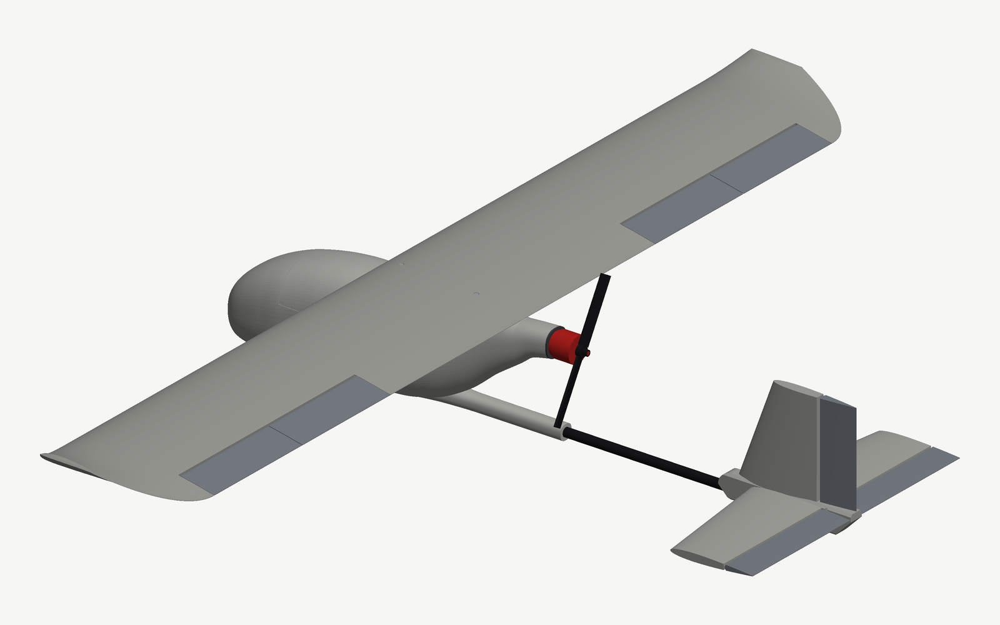

# Pusher 1290

A 3D-printable 1290 mm pusher RC plane for the Bambu Lab A1 mini. It's an original parametric airframe with the same layout as the Flightory Lark (a pod fuselage, a pusher motor behind the wing, a carbon tail boom and a conventional tail), but it uses none of Flightory's geometry. Every printed part fits a 180 × 180 × 180 mm bed with 2 mm to spare on each side. Every bought part is a common one you can order on Amazon.

**Build manual with 3D viewer and assembly video: [hassan.umari.dev/pusher_1290](https://hassan.umari.dev/pusher_1290/)**



| | |
|---|---|
| Wingspan / length | 1290 mm / 865 mm |
| Wing | SD7037, 200 mm chord, 1.5° incidence, 0.25 m² (see [AERODYNAMICS.md](AERODYNAMICS.md)) |
| Tail | NACA 0009 stab at −1° incidence (376 mm span), NACA 0012 fin, tail volume 0.50 (H) / 0.030 (V) |
| Printed parts | 26 STLs, about 880 g in PLA |
| All-up weight | about 1.84 kg with a 4S 5200 mAh LiPo and the nose weight |
| Centre of gravity | **66 mm behind the wing LE** (range 57–77). The neutral point is at 93 mm. |
| Performance (model) | best L/D 15.3 at 15 m/s (54 km/h); minimum power 32 W at 12 m/s |

> **Not flight-tested.** The geometry is checked for fit, printability, collisions and balance. The aerodynamic numbers come from AeroSandbox models, not wind-tunnel or flight data. Do range checks, a CG check and a few gentle hand-launch glides before the first powered flight.

## Files

- `stl/` – one STL per part, oriented and centred for the A1 mini. Load them into Bambu Studio as they are. `stl/PARTS.md` lists sizes, materials and notes.
- `assembly/pusher_1290_full.3mf` – the complete plane: every printed part plus carbon, bolts, servos, linkages, motor, prop, battery and avionics, each a named, coloured object. `pusher_1290_full.stl` is the same as one mesh; `pusher_1290.stl` is the printed parts only.
- `video/pusher_1290_assembly.mp4` – the assembly from the builder's seat: every part starts laid out on the bench and goes on in order, with captions.
- `manual/` – the interactive build manual, published to GitHub Pages on every push to `main`.
- `renders/` – previews. `parts_sheet.png` shows every part on the bed; `internals.png` shows the pod layout.
- `cad/` – the Python source. Every dimension is in `cad/params.py`; every bought part (size, mass, position) is in `cad/hardware.py`.
- `aero/` – the aerodynamic model; `aero/report.py` writes [AERODYNAMICS.md](AERODYNAMICS.md).

To rebuild after changing a parameter:

```sh
python3 -m venv .venv && .venv/bin/pip install -r requirements.txt
.venv/bin/python cad/build.py        # parts must fit the bed
.venv/bin/python cad/assembly.py     # no collisions, and the PLA build must balance
```

`AGENTS.md` lists the full regeneration chain (print check, manual, aero report, video).

## Printing (Bambu Studio, 0.4 nozzle, 0.2 mm layers, PLA)

| Parts | Wall loops | Sparse infill | Top/bottom layers | Notes |
|---|---|---|---|---|
| Wing centre, S1, S2, S3 | 1 | 0 % | 3 | The 0.45 mm skin and internal walls are modelled in; set the wall line width to 0.45 mm. |
| Wing tips, ailerons, stab, elevators, rudder, fin hub | 1 | 5 % gyroid | 3 | Solid parts. Use a 5 mm brim on the tall thin ones. |
| Fuselage segments, hatch | 2 | 10 % gyroid | 3 | 0.8 mm shell. Infill only fills the boom-socket walls. |
| `motor_mount`, `fuse_4_tail_motor_cone` | 4 | 40 % | 4 | **PETG.** These carry the motor and run warm. |

- No supports needed. Overhangs are held to 45° with chamfers and teardrop holes. The exceptions are a few short bridges: the servo-pocket ceilings in S2 and the ring around the camera hole. If your printer bridges poorly, turn on *Thick bridges*.
- `fuse_3_rear` stands on a small ring next to a free-standing boom-socket column, so give it a brim.
- Foamed PLA (LW-PLA, Bambu PLA Aero) also works and saves about 480 g. Then the plane is nose-heavy: leave out the nose weight and move the battery about 30 mm back.
- PLA softens around 55 °C. Don't leave the plane in a hot car.

## What to buy

Everything is a common Amazon part; search for the name given.

| Item | Search for | Qty |
|---|---|---|
| Motor | EMAX ECO II 2807 1300KV (19 × 19 mm M3 mount) | 1 |
| Propeller | 7 inch FPV prop, reverse rotation (e.g. 7040) | 1 |
| ESC | Hobbywing Skywalker V2 40A (5 A BEC) | 1 |
| Servos | MG90S metal-gear 9 g micro servo | 4 |
| Flight controller | SpeedyBee F405 WING APP | 1 |
| GPS | Beitian BN-880 (with compass) | 1 |
| Receiver | RadioMaster RP1 ELRS 2.4 GHz | 1 |
| Camera, VTX | Caddx Ratel 2 (19 mm), 5.8 GHz VTX (30.5 mm mounting) | 1 each |
| Battery | 4S 5200 mAh LiPo, XT60, at most 140 × 48 × 48 mm | 1 |
| Carbon tube 10 × 8 mm | main spar | 1 × 1000 mm |
| Carbon tube 6 × 4 mm | rear spars, stab spar | 2 × 590 mm, 1 × 130 mm |
| Carbon tube 12 × 10 mm | boom | 1 × 490 mm |
| Carbon rod 3 mm | stab pin, aileron joiners | 3 × 80 mm |
| Piano wire 2 mm | elevator joiner | 1 × 100 mm |
| Bowden cable (2 mm tube, 1 mm steel pushrod) | elevator and rudder | 2 × ~700 mm |
| Steel pushrod 1.2 mm with clevis | ailerons | 2 |
| Nylon control horns | | 4 |
| CA hinges | | ~14 |
| M3 brass heat-set inserts (5.7 mm) | wing bolts | 2 |
| M3 socket head screws | wing: 1 × 20 mm, 1 × 14 mm; motor: 4 × 14 mm | 6 |
| Adhesive lead wheel weights | nose weight | ~92 g |
| Magnet 6 × 3 mm | hatch | 1 |

Every bought part is modelled at true size and mass in `cad/hardware.py`. `cad/assembly.py` checks that each one fits without touching printed material, derives the bolt and spar lengths above from the geometry, and checks the balance. If you buy something different, change its entry and rerun it.

**Battery and balance:** the battery lies on the floor, as far forward as it goes, and slides in with the nose off. A single 140 mm LiPo is longer than the hatch opening. Even with the battery forward, the PLA plane needs about 92 g of lead low in the nose, below the camera, to balance at 66 mm. Add or remove weight until it balances.

## Assembly

1. **Wing.** Slide the 10 mm spar and the two 6 mm rear spars through the centre section, then S1, S2 and S3 on each side, gluing each joint with medium CA or 5-minute epoxy. Glue the tips on; the rear spars end 35 mm inside them. Lay an MG90S flat in each pocket under S2, spline toward the trailing edge, and run its lead through the wing to the hole under the centre section.
2. **Ailerons.** Glue a 3 mm rod through the inner and outer aileron so they move as one. Hinge them on the bevel's apex line, which allows ±30° of throw. Glue a horn under each inner aileron and link it to the servo with a 1.2 mm Z-bend pushrod.
3. **Fuselage.** Glue the front segment to the rear, and both tail-cone pieces to the rear, on the 10 mm sleeves. Melt the two M3 inserts into the bosses under the wing saddle. Glue the elevator and rudder servos upright between the floor rails, and the flight controller and ESC behind them. Bolt the motor to `motor_mount`, then glue the mount into the cone.
4. **Boom.** Glue the 12 mm tube 160 mm into the fuselage socket and 110 mm into the tail hub; square the fin to the wing first. Push the two Bowden cables from the tail servos through the boom. They come out of the hub beside the elevator and the rudder.
5. **Tail.** Put the stab halves on the 6 mm spar and 3 mm pin through the hub. Hinge the elevators and join them with the 2 mm wire through the hub slot, then hinge the rudder. Glue a horn under the left elevator and one on the right of the rudder, and Z-bend the Bowden pushrods into them.
6. **Wing on, battery in, balance.** Bolt the wing into the saddle (M3 × 20 front, M3 × 14 rear). Slide the battery in along the floor, fit the nose (tape or a screw: it stays removable), and hook the hatch's front tab under the skin. Balance at 66 mm behind the leading edge with lead in the nose.

Suggested first throws: ailerons ±12°, elevator ±10°, rudder ±15°. Seal the aileron and elevator hinge gaps with clear tape; it's free drag reduction.
